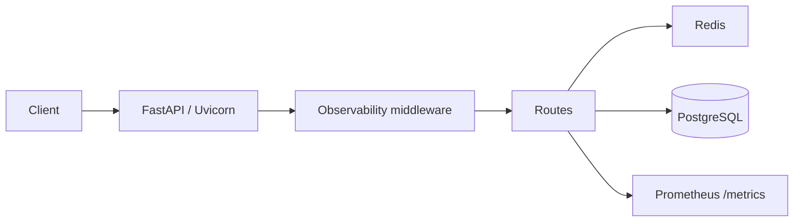
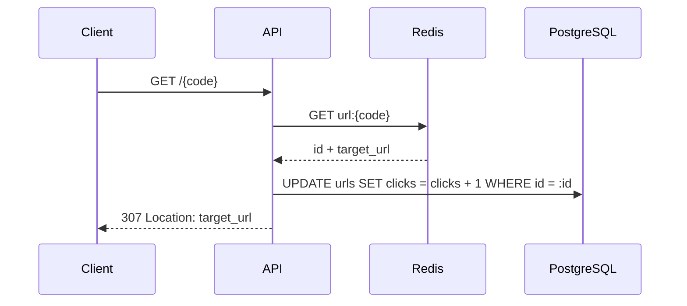
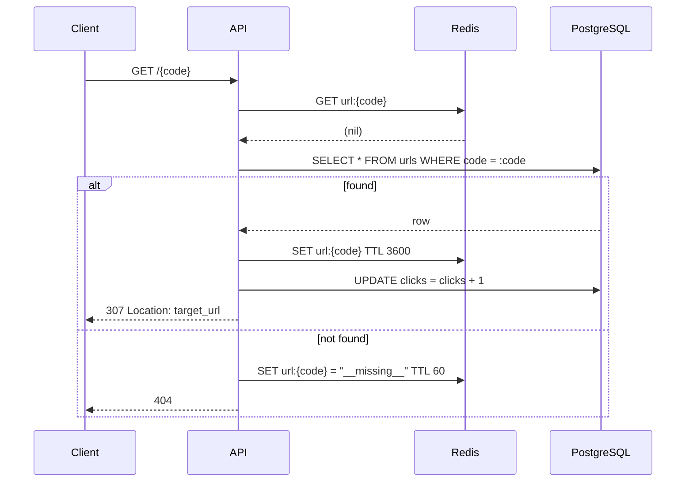
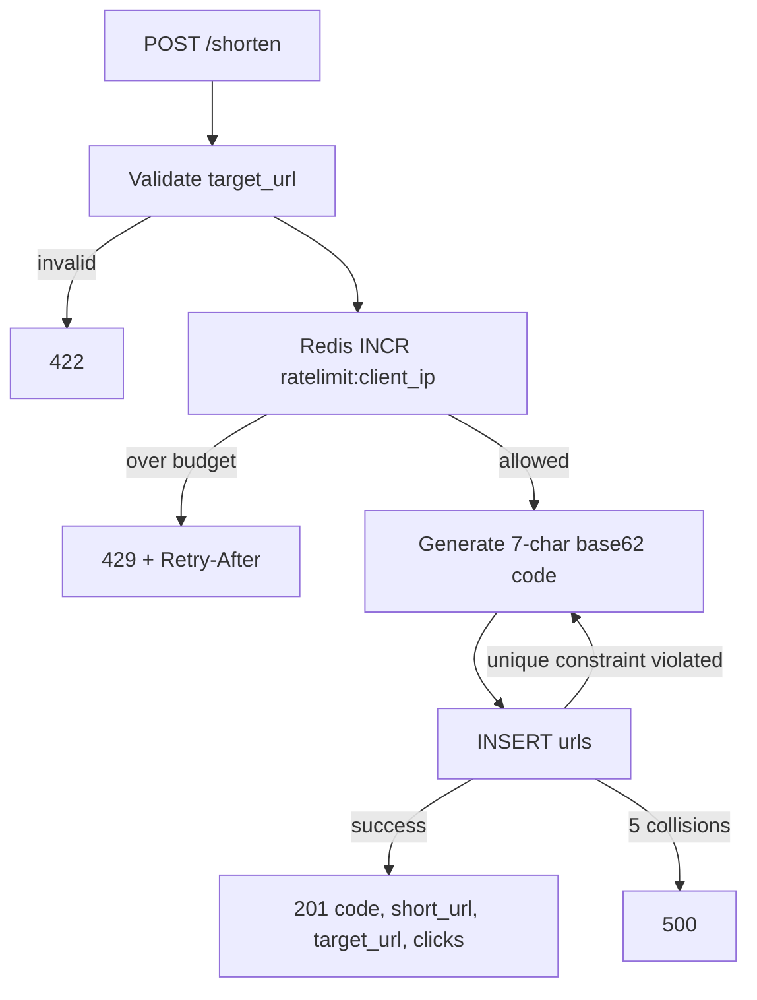

# Architecture

The service is a single FastAPI process backed by PostgreSQL (system of record)
and Redis (cache and rate-limit counters). Every request passes through the
observability middleware, which assigns a request ID, logs one JSON access line
and records HTTP metrics.

## Redirect: cache hit

The cached value carries both the row id and the target URL, so a hit avoids a
Postgres `SELECT` while still allowing the atomic click update. Redis is not the
system of record for clicks.

## Redirect: cache miss

If Redis raises an error at any point, the API logs a warning, skips the cache
and continues against Postgres. Negative caching protects the database from
repeated 404s for the same code.

## Create

Code uniqueness is enforced by the database, not by a pre-flight query, because
a check-then-insert would race. Collisions are rare (62^7 keyspace) but handled
correctly.
